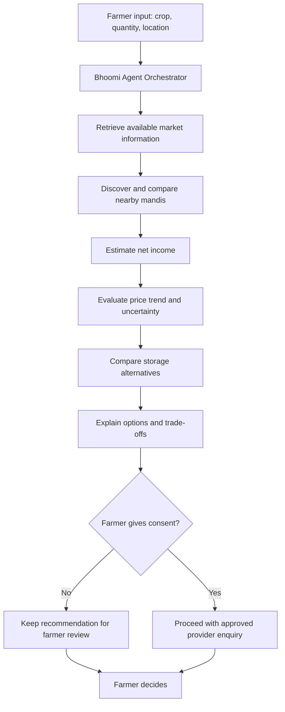
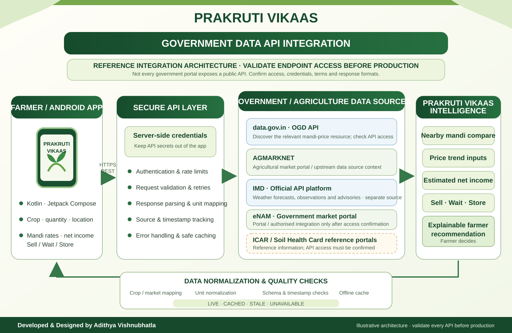
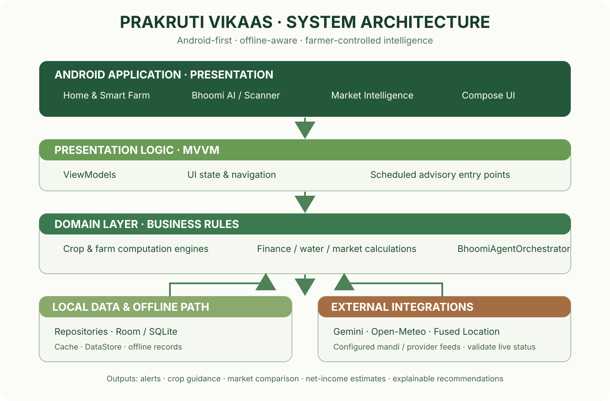
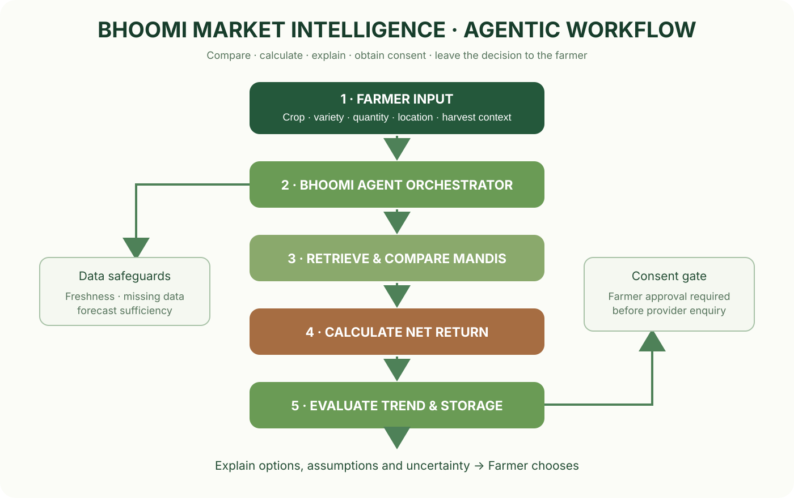
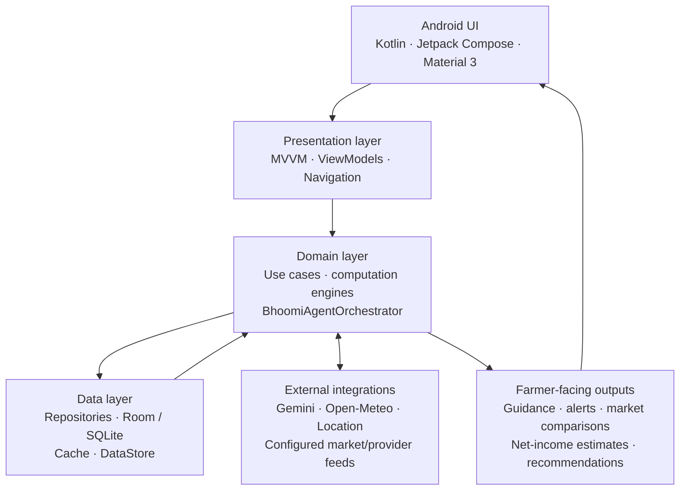

# PRAKRUTI VIKAAS 🌱
### AI That Helps Every Farmer Make a Better Decision

**Developed & Designed by Adithya Vishnubhatla**

🌐 **Live Website:** [https://prakrutivikaas.vercel.app/](https://prakrutivikaas.vercel.app/)

PRAKRUTI VIKAAS is an Android-first agricultural intelligence companion that brings crop guidance, farm records, weather information, soil and water tools, and market decision support into one farmer-focused application.

> **Hackathon focus:** Help farmers make better-informed selling decisions by comparing nearby markets, estimating net returns, evaluating price trends, and considering storage alternatives — while keeping the farmer in control.

## The problem

A mandi price quote is not the same as the farmer's actual return. Transport, loading, handling, fees, distance, crop perishability, storage costs and price uncertainty all affect the decision. Farmers also need reliable crop, soil, weather and irrigation guidance throughout the growing cycle, often with limited connectivity.

## Our approach

PRAKRUTI VIKAAS combines daily farm intelligence with a connected market workflow:

1. Capture farm context — crop, quantity, location and records.
2. Retrieve available weather and market information.
3. Compare nearby mandis and available price observations.
4. Estimate net income after entered or available selling costs.
5. Examine historical price trends and forecast uncertainty when sufficient data exists.
6. Compare sell-now and storage scenarios.
7. Present an explainable recommendation; the farmer decides whether to act.

The application does not autonomously sell produce or contact providers without farmer consent.

## Core capabilities

### Farm intelligence
- GPS or manually selected location context.
- Weather information and hourly / multi-day forecasts, with local caching.
- Scheduled weather/advisory checks (not continuous monitoring).
- Smart Farm home-screen widget.
- Offline-first farm records and local persistence.

### AI and crop care
- **Bhoomi AI:** Gemini-powered conversational agricultural assistance with farm context and multilingual interactions.
- **Plant Scanner:** Image-based plant analysis and scan history.
- **Crop Doctor:** Crop-health and disease/pest guidance with practical next steps.
- Image suitability checks and uncertainty-aware handling; uncertain results should not be presented as guaranteed diagnoses.

### Land, soil and growing cycle
- Farms, plots and plot-boundary records.
- Soil information and nutrient guidance workflows.
- Sunlight and microclimate observations.
- Terrace plants and plant records.
- Crop suitability and comparison workflows.
- Seeds and agricultural input inventory.
- Germination records and compost tracking.
- Irrigation guidance, water ledger and water-use records.
- Harvest calendar and crop timeline.
- Digital farm journal and activity records.

### Farm finance
- Financial ledger and expense records.
- Receipt image capture and OCR-assisted extraction.
- Expense categorisation and cost summaries.

### Bhoomi Market Intelligence
The market experience is organised into seven connected modules:

1. **Dashboard** — harvest and market overview.
2. **My Harvest** — crop, variety, quantity and harvest records.
3. **Mandi Rates** — available minimum, maximum and modal price observations with data freshness/status.
4. **Nearby Mandis** — location-aware market discovery and distance comparison.
5. **Net Income Calculator** — estimated gross and net sale value after relevant costs.
6. **AI Forecast & Sell-or-Wait** — trend analysis, forecast ranges and safeguards when history is insufficient.
7. **Storage & Multi-Agent Coordination** — storage scenario/ROI comparison and consent-based provider enquiry workflows.

Market data freshness matters. The application should distinguish **LIVE**, **CACHED**, **STALE**, **SAMPLE_DEMO** and **UNAVAILABLE** states where applicable. Government market-feed configuration does not itself prove that a live feed is working; verify the current endpoint, key, response and timestamp before presenting data as live.

## Agentic decision workflow



## Live project website

Explore the PRAKRUTI VIKAAS website: **[prakrutivikaas.vercel.app](https://prakrutivikaas.vercel.app/)**

## Government data API integration architecture

The following reference diagram illustrates the app-to-service flow for mandi and related government information sources. It is an integration architecture, not a claim that every listed portal exposes a public API. Confirm API availability, permissions, credentials, response fields and timestamps before enabling a production integration.



## Architecture diagrams

### System architecture



### Agentic market workflow



## System architecture



The design is offline-first for locally stored farm records and cached information. Fresh cloud AI, weather or market information requires connectivity. External integration availability must be tested in the target environment.

## Technology stack

| Area | Technology |
|---|---|
| Platform | Android |
| Language | Kotlin |
| UI | Jetpack Compose, Material 3 |
| Architecture | MVVM / Clean Architecture |
| Local database | Room / SQLite |
| Preferences | DataStore |
| AI | Firebase AI / Gemini integration |
| Weather | Open-Meteo |
| Location | Google Fused Location Provider |
| Networking | Retrofit, OkHttp, Moshi |
| Asynchronous work | Kotlin Coroutines and Flow |
| Image loading | Coil Compose |
| Dependency processing | KSP |

## Technical implementation notes

The project technical architecture report records:
- Android v2.2.1, Build 5.
- 22 navigable destinations.
- 6 supported languages: English, Telugu, Hindi, Kannada, Tamil and Marathi.
- 38 Room entities/tables and 20 DAOs.
- 27 Kotlin computation engines.
- 7 market-intelligence tabs.
- 70/70 automated tests recorded as passing in that report.

These are report-recorded implementation figures, not an independent certification. Verify against the current source tree and latest test run before relying on them as current release metrics.

## Data, safety and trust

- Do not commit API keys, signing keys, credentials, personal farmer data or local machine configuration.
- Treat market feeds as unverified until a successful response, expected schema and update time have been checked.
- Keep observed values separate from model-generated estimates and forecasts.
- Display uncertainty and data freshness.
- Do not manufacture a crop diagnosis or forecast when evidence is insufficient.
- Require farmer approval before provider enquiries or external coordination.
- Financial and credit-scheme information is informational; the app does not originate or approve loans.

## Repository contents

This repository is intentionally maintained as a **public project showcase and technical documentation hub**. The Android application source code is not published here.

```text
prakruti-vikaas-project/
├── README.md
├── .gitignore
├── CONTRIBUTING.md
├── docs/
│   ├── PROJECT_OVERVIEW.md
│   ├── SYSTEM_ARCHITECTURE.md
│   ├── MARKET_INTELLIGENCE.md
│   ├── AGENTIC_WORKFLOW.md
│   ├── API_AND_CONFIGURATION.md
│   ├── PRIVACY_AND_SECURITY.md
│   └── TESTING.md
└── architecture/
    ├── system-architecture.svg
    └── agentic-market-workflow.svg
```

The repository helps reviewers, mentors and collaborators understand the product, architecture, workflows, technical approach and validation status without exposing the private implementation.

## Project access and demonstration

- **Source code:** Not publicly shared in this repository.
- **Application walkthrough:** Add a link to a demonstration video when available.
- **Screenshots:** Add genuine screenshots from the running application when available.
- **Presentation:** Add the final hackathon pitch deck or its share link when ready.
- **APK:** Share a release or download link only when a tested build is ready and it is appropriate to distribute.

This repository is documentation-only; it does not provide a public Android build or developer setup instructions. Do not publish API keys, signing credentials, private farmer data or internal configuration here.

## Roadmap

- Verify live mandi data retrieval and freshness.
- Validate forecast accuracy using suitable historical data and disclose uncertainty.
- Expand verified storage and provider coverage.
- Strengthen regional-language and low-connectivity experiences.
- Continue validating end-to-end farmer scenarios.

## Developer

**Adithya Vishnubhatla**  
Conceptualisation · Product design · Architecture · Development

- GitHub: [@adithyavishnubhatla8](https://github.com/adithyavishnubhatla8)
- Project repository: [prakruti-vikaas-project](https://github.com/adithyavishnubhatla8/prakruti-vikaas-project)

---

*PRAKRUTI VIKAAS — One smartphone. Smarter decisions. Better farming.*
